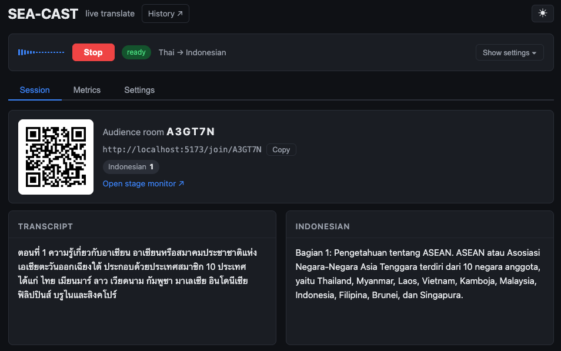
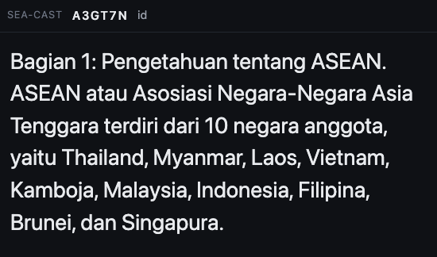
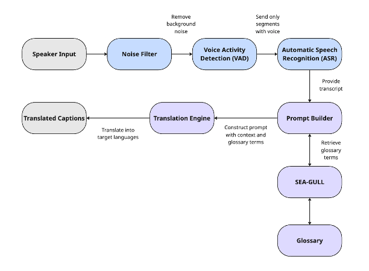
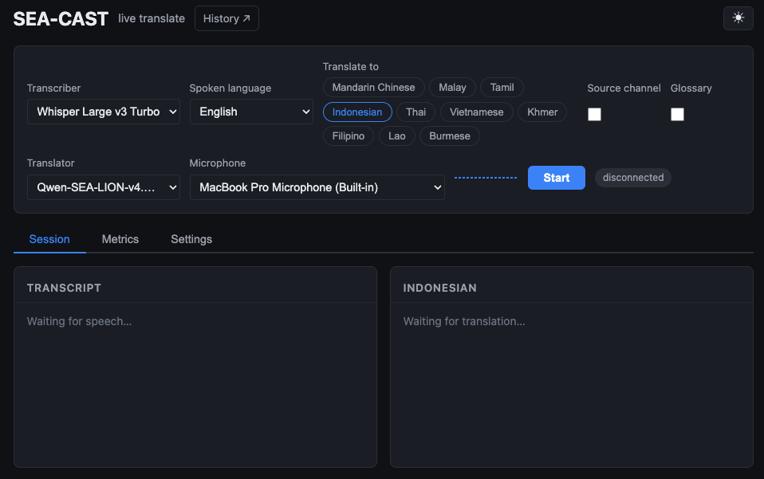

# SEA-CAST (**S**outh**E**ast **A**sian **C**onference **A**ssistant for **S**peech **T**ranslation)

SEA-CAST ([demo](https://sea-cast.sea-lion.ai)) is a live speech-to-text translation application for talks and conferences,
built for Southeast Asian languages.

<p align="center">
  
  
  <sub>Left: Thai speech translated into Indonesian live. (Speaker Dashboard) | Right: What audiences see (Audience Room)</sub>
</p>

## Contents

1. [Features](#1-features)
   - [Languages](#languages)
2. [How it works](#2-how-it-works)
3. [Quickstart](#3-quickstart)
4. [Using SEA-CAST](#4-using-sea-cast)
   - [A. Using the Speaker Dashboard](#a-using-the-speaker-dashboard)
   - [B. Other Settings](#b-other-settings)
   - [C. Getting captions to the audience](#c-getting-captions-to-the-audience)
5. [Configuration](#5-configuration)
6. [Setting up the services](#6-setting-up-the-services)
   - [A. Speech-to-text](#a-speech-to-text)
   - [B. Translation](#b-translation)
7. [Glossary (Optional)](#7-glossary-optional)

- [License](#license)
- [Contact](#contact)

## 1. Features

- **Speaker dashboard**: Pick a microphone, the spoken language and up to five
  caption languages and start a session.

- **Audience captions**: Every session starts an audience room with a QR code/URL,
  which audiences can join with their phones (when deployed online) or watch on a
  screen (when run locally). The audience can choose the language they want to read
  and can switch at any time. Phones show the last 90 seconds of captions, and
  anyone who joins late, reconnects or switches language gets those 90 seconds too.

- **Stage monitor**: A full-screen view of the live transcript, if needed, for the
  speaker.

- **Customizable translation pipeline**: Mix and match any compatible speech-to-text
  and translation model/service (OpenAI-compatible APIs, ElevenLabs realtime ASR).

- **Glossary support**: Add a [SEA-GULL](https://github.com/aisingapore/seagull)
  glossary to translate entities/terms more accurately.

- **Recordings and history**: Each session saves its audio, transcript,
  translations, glossary use and metrics. Viewable and downloadable on an admin page.

- **Noise filter**: Optional RNNoise filter for noisy venues.

### Languages

Languages supported by our demo are as follows:

**Translations:** English, Mandarin Chinese, Malay, Tamil, Indonesian, Thai, Vietnamese,
Khmer, Filipino, Lao and Burmese.

**Speech-to-text (ASR):** All languages under translations, plus Cantonese and Hokkien
(use MERaLiON3 for these two). Some models support auto-detection (e.g. ElevenLabs
Scribe and MERaLiON3).

Language support here does not mean equally good performance across all listed languages.
Expect poorer performance for lower-resourced languages like Khmer, Lao and Burmese.
Each model/service supports a different set of languages, with unsupported ones
unavailable for selection on the demo app interface.

For your own deployments, you may plug in any model to support any language, provided
you make the appropriate edits to `languages.yaml`.

## 2. How it works

1. The speaker's speech first passes through an optional noise filter and then a voice activity
detection (VAD) layer. The VAD layer extracts speech segments from the incoming audio stream
and passes it on. For realtime streaming services like ElevenLabs, the service does this by
itself.

2. The Speech-to-text (STT)/ Automatic Speech Recognition (ASR) component receives the speaker's
audio with the speaker's utterances and transcribes them into text.

3. A prompt construction layer optionally triggers glossary retrieval and bakes retrieved
entities/terms and their translations into the prompt for the translation model downstream.

4. The translation model follows the given instructions and translates the incoming transcripts
into the target language(s), with help from the glossary where applicable.

5. Translated captions are fanned out into audience rooms for the audience to follow.

The backend is a Python [Pipecat](https://github.com/pipecat-ai/pipecat) pipeline
served via FastAPI, while the frontend is React.




## 3. Quickstart

`quickstart.sh` runs a fully local stack: [whisper.cpp](https://github.com/ggml-org/whisper.cpp)
for speech-to-text, [Ollama](https://ollama.com) for translation, and SEA-CAST
itself. You need:

- [uv](https://docs.astral.sh/uv/getting-started/installation/) and [Node.js](https://nodejs.org/) 20 or later
- whisper.cpp's server, `whisper-server` ([See how to set up here](#a-speech-to-text))
- [Ollama](https://ollama.com/download)

```bash
git clone https://github.com/aisingapore/sea-cast
cd sea-cast
bash ./quickstart.sh
```

The first run does the following:
1. Checks for these tools
2. Creates `backend/sea-cast.yaml` and installs dependencies
3. Offers to download the default Whisper model, `large-v3-turbo-q5_0` (about 550 MB)
4. Pulls the default translation model, [Gemma-SEA-LION v4.5 E2B](https://ollama.com/aisingapore/Gemma-SEA-LION-v4.5-E2B-IT) (4.4 GB)
5. When everything is up it prints the dashboard address, <http://localhost:5173>.

**Other models.** The defaults come from `backend/sea-cast.yaml` (which is copied from
`backend/sea-cast.example.yaml` on the first run), and `quickstart.sh` starts the app using
the profiles listed in there. To use a model different from the defaults, edit the `model`
of its profile and run `bash ./quickstart.sh` again:

- **Whisper:** The profile at `http://localhost:8000/v1`. Use a model name from
  the [whisper.cpp model list](https://huggingface.co/ggerganov/whisper.cpp/tree/main)
  without `ggml-` and `.bin`, e.g. `small` (faster on a CPU, less accurate) or
  `large-v3`. The script will offer to download it. If you already have a whisper model
  downloaded, run `WHISPER_MODEL_FILE=/path/to/ggml-model.bin bash ./quickstart.sh`.

- **Translation:** Replace the `model` under the Ollama profile with an
  [Ollama model](https://ollama.com/search) tag, e.g. `gemma4:e4b`. You can list multiple
  translator profiles using Ollama if you wish to: the script pulls the model of every
  profile at `http://localhost:11434/v1`. We recommend keeping this in each Ollama profile,
  since many models think before answering, which delays captioning significantly:

  ```yaml
  extra_body:
    reasoning_effort: none
  ```

If you wish to go beyond Whisper and Ollama, you may add other profiles that use endpoints
that are OpenAI-compatible (see [6. Setting up the services](#6-setting-up-the-services)).
ElevenLabs realtime ASR is also supported.

`quickstart.sh` starts whisper.cpp and Ollama only for the profiles that use them
(`localhost:8000` and `localhost:11434`), and always starts SEA-CAST itself. Hosted
profiles, such as ElevenLabs or the SEA-LION API, need only their key in `backend/.env`
(copy `backend/.env.example` to `backend/.env` first); other local servers, such as vLLM,
must already be running.

## 4. Using SEA-CAST



### A. Using the Speaker Dashboard

1. **Start a session:** On the dashboard, choose the transcriber, the
   translator, the spoken language and the caption languages, then press Start.

2. **Share the room:** A panel shows the QR code and join link, and how many
   people are listening in each language. Whether phones can use them depends on
   where SEA-CAST runs; see [Getting captions to the audience](#c-getting-captions-to-the-audience).

3. **Show the monitor:** If you have a screen facing the speaker, you can show the
   monitor view via `/monitor/<room code>`. (A link saying "Open stage monitor" will
   appear beside the QR code.)

4. **Stop the session:** The room tells listeners it has ended, and the
   recording is saved.

5. **Review it later:** You can access the history via the `History` button at the
   top of the page. (Requires admin login. Set `ADMIN_USERNAME` and `ADMIN_PASSWORD`
   in `backend/.env` to allow access.)

### B. Other Settings

#### 1. Source Channel

Select the checkbox that says `Source channel` if you want the transcript in the
spoken language to be made available to audiences too.

#### 2. Glossary

If you wish to use a glossary to make translation of entities/terms more accurate,
select the checkbox that says `Glossary`. (See [7. Glossary (Optional)](#7-glossary-optional)
on how to set up the glossary on the backend before starting the application.)

#### 3. Settings Tab

The Settings tab provides additional customizations to the user.
Apply these settings before pressing Start.

1. `Noise filter`: Removes background noise for noisy settings.

2. `Endpoint Silence`: How long a speaker must pause for the current
utterance to count as finished and sent for transcription by the VAD.
Shorter allows faster captioning, but may split sentences, while longer
keeps sentences together, but captions will arrive later as it has to wait
for more speech to be transcribed.

3. `VAD Sensitivity`: (Only for ElevenLabs ASR) How sensitive ElevenLabs' VAD
is. Lower means more sensitive.

4. `VAD Confidence`: (Only for OpenAI-compatible ASR) How confident the VAD
must be that speech has started before it starts listening. Consider raising it
if background noise like coughs, applause or background chatter get transcribed.

5. `Max Segment`: (Only for OpenAI-compatible ASR) It is possible for an utterance
to end only after a very long continuous segment of speech if the speaker barely
pauses (depending on Endpoint Silence settings as well). To avoid having the
VAD listen indefinitely and leaving audiences without any transcripts/translations
for a long time, you can set the maximum time before an utterance is forced to be
completed and sent for transcription. (Defaults to 8 seconds. Selecting 0 seconds
turns the setting off.)

### C. Getting captions to the audience

#### Deployed on a server (with a public HTTPS address)
On our [demo](https://sea-cast.sea-lion.ai), or any deployment with a public HTTPS
address, the audience can scan the QR code/use the link provided and read captions
on their phones/devices. (This repository is set up for running locally; it doesn't
include deployment files or instructions.)

#### Run locally
The dashboard is on `localhost`, so the QR code and join link point to `localhost`
too, and phones can't open them. Instead, show the captions on a screen in the room:

1. On the speaker's machine, open the join link from the room panel in another
   browser window.
2. Pick a caption language.
3. Move the window to a projector or second display and make it full screen.

## 5. Configuration

SEA-CAST reads two files in `backend/` to set the application up:

| File | What goes in it |
|---|---|
| `sea-cast.yaml` | The speech-to-text and translation services ("profiles"), the system prompt, and the glossary. See [`sea-cast.example.yaml`](backend/sea-cast.example.yaml) for an example. |
| `.env` | Mainly secrets: the API keys your profiles need and the admin login. See [`.env.example`](backend/.env.example) for an example. |

A profile is one service the dashboard can pick. The first profile in each list
is the default:

```yaml
stt_profiles:
  - id: whisper-local
    label: Whisper (local)          # shown on the dashboard
    adapter: openai                 # any OpenAI-compatible /audio/transcriptions API
    base_url: http://localhost:8000/v1
    model: large-v3-turbo-q5_0      # the model the server expects
    languages: whisper-large-v3     # a preset from languages.yaml, or a list

translator_profiles:
  - id: sealion
    label: SEA-LION
    base_url: https://api.sea-lion.ai/v1
    model: aisingapore/Qwen-SEA-LION-v4.5-27B-IT
    api_key_env: SEALION_KEY        # the key itself goes in .env
    extra_body:
      chat_template_kwargs:
        enable_thinking: false
```

Keys never go in `sea-cast.yaml`: A profile names an environment variable, and
`.env` holds the corresponding value. SEA-CAST checks the whole configuration
when it starts, and stops with a message naming the profile and field if something
is wrong or a key is missing.

Every profile field (authentication, languages, adapter options) is explained in
the comments in [`sea-cast.example.yaml`](backend/sea-cast.example.yaml).

### `.env` settings

Besides the API keys your profiles name, these are all optional.

| Variable | Default | Purpose |
|---|---|---|
| `ADMIN_USERNAME`, `ADMIN_PASSWORD` | unset | Turn on the `/history` page (it stays locked without both). |
| `CORS_ORIGINS` | none | Frontend addresses allowed to call the backend, written as a JSON list (e.g. `["http://localhost:5173"]`). `quickstart.sh` sets this for you unless `.env` already sets it; if you set it, include `http://localhost:5173`. |
| `SEA_CAST_CONFIG` | `sea-cast.yaml` | The config file to load. |
| `RECORDINGS_DIR` | `./recordings` | Where sessions are saved. |

**Dashboard defaults.** The starting value of each dial under the Settings tab. The user can still
change it on the frontend if desired.

| Variable | Default | Control |
|---|---|---|
| `VAD_STOP_SECS` | `0.7` | Endpoint silence, for `openai`-adapter profiles (ElevenLabs profiles set theirs in `sea-cast.yaml`). |
| `VAD_CONFIDENCE` | `0.7` | VAD confidence, for `openai`-adapter profiles. |
| `STT_MAX_SEGMENT_SECS` | `8` | Max segment, for `openai`-adapter profiles (`0` turns it off). |

<details>
<summary>Fine tuning (rarely needed)</summary>

| Variable | Default | Purpose |
|---|---|---|
| `VAD_START_SECS` | `0.2` | Seconds of speech before the voice detector reports that speech started. Higher ignores short noises but can miss very short words. |
| `VAD_MIN_VOLUME` | `0.6` | Loudness (0–1) that counts as speech. Raising it can cut off quiet speakers. |
| `ROLLING_WINDOW_N` | `4` | Earlier sentences sent with each translation as context. |
| `TRANSCRIPTION_DRAIN_SECS` | `0.5` | On Stop, how long to wait for the last transcript. |
| `TRANSLATION_DRAIN_SECS` | `15` | On Stop, the longest to wait for translations still in progress. |
| `WS_SESSION_TIMEOUT_SECS` | none | Ends a speaker connection that has been idle this long. |
| `JWT_TTL_SECS` | `21600` (6 h) | How long audience and admin logins last. |
| `ROOM_TTL_SECS` | `43200` (12 h) | How long a room is kept after it's created. |

</details>

## 6. Setting up the services

### A. Speech-to-text

#### 1. whisper.cpp

- **macOS:** `brew install whisper-cpp`. On Apple Silicon it uses the GPU (Metal)
  automatically.
- **Linux and WSL:** build it with CMake.

  ```bash
  git clone https://github.com/ggml-org/whisper.cpp && cd whisper.cpp
  cmake -B build              # -DGGML_CUDA=1 if using NVIDIA GPU
  cmake --build build -j --config Release
  ```

  The server is `build/bin/whisper-server`. Run
  `WHISPER_BIN=/path/to/whisper-server bash ./quickstart.sh`.

For more information on setting up whisper.cpp, please refer to their [repo](https://github.com/ggml-org/whisper.cpp).

To run whisper.cpp yourself (not via `quickstart.sh`):

```bash
whisper-server -m ggml-large-v3-turbo-q5_0.bin --port 8000 \
    --inference-path /v1/audio/transcriptions -l auto
```

#### 2. vLLM
vLLM can serve Whisper-family and other speech models with the same OpenAI-compatible
API; point an `adapter: openai` profile's `base_url` at it.

#### 3. Other hosted APIs
For OpenRouter or any other OpenAI-compatible transcription API, add
an `adapter: openai` profile with its `base_url` and an `auth` key. For
ElevenLabs realtime transcription, use `adapter: elevenlabs`. The example config
has a commented profile for each.

### B. Translation

#### 1. Ollama
Install [Ollama](https://ollama.com/download), then pull a model:

```bash
ollama pull <model_name>
```

Ollama serves an OpenAI-compatible API at `http://localhost:11434/v1`. The example config's
first translator uses it.

#### 2. vLLM

On a machine with a GPU large enough for the model:

```bash
vllm serve <model_name> --port 8001
```

Then add a profile for it:

```yaml
  - id: sealion-vllm
    label: SEA-LION (vLLM)
    base_url: http://<your-server>:8001/v1
    model: <model_name>                            # the name vLLM serves it as
    extra_body:                                    # sent with every request
      chat_template_kwargs:
        enable_thinking: false                     # answer directly, no reasoning
```

#### 3. Hosted APIs
For the SEA-LION API, OpenRouter or any other OpenAI-compatible chat API: set `base_url`, `model`
and `api_key_env`, and put the key in `.env`. The example config has a SEA-LION profile ready
to uncomment.

The translation instructions sent to the model live in
[`backend/app/prompts/system_prompt.md`](backend/app/prompts/system_prompt.md):
edit them to suit your needs.

## 7. Glossary (Optional)

With a [SEA-GULL](https://github.com/aisingapore/seagull) glossary, each
translation is told exactly how to render the names and terms the speaker just
used. Point the config at the glossary file:

```yaml
glossary:
  path: data/my_glossary.jsonl   # relative to backend/
```

The dashboard's Glossary checkbox then becomes available (on by default), and
each session records which terms it found. Refer to
[SEA-GULL](https://github.com/aisingapore/seagull) to see how to set up a
SEA-GULL glossary.

For each sentence and each caption language, the prompt-building component of
SEA-CAST looks up the terms the speaker used and adds them to the end of the
system prompt, after a blank line. For "ASEAN is an intergovernmental
organization..." translated into Thai, the system prompt ends with:

```
Use these exact term translations wherever the source term appears:
ASEAN -> อาเซียน
```

Only terms with a form in that caption language are listed, and when the glossary
gives several forms, the first is used. A sentence with no matching terms gets the
system prompt unchanged. The wording is set in
[`backend/app/translation/terminology.py`](backend/app/translation/terminology.py)
(`GLOSSARY_INSTRUCTION`).


## License

The code for SEA-CAST is licensed under the MIT license.

## Contact

If you have any questions or would like to contribute, please reach out to sealion@aisingapore.org